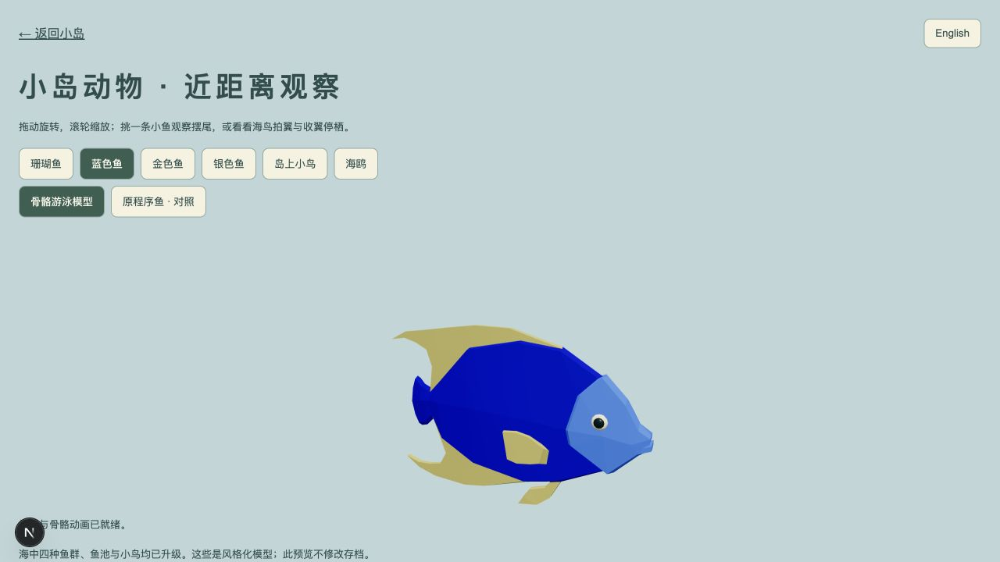
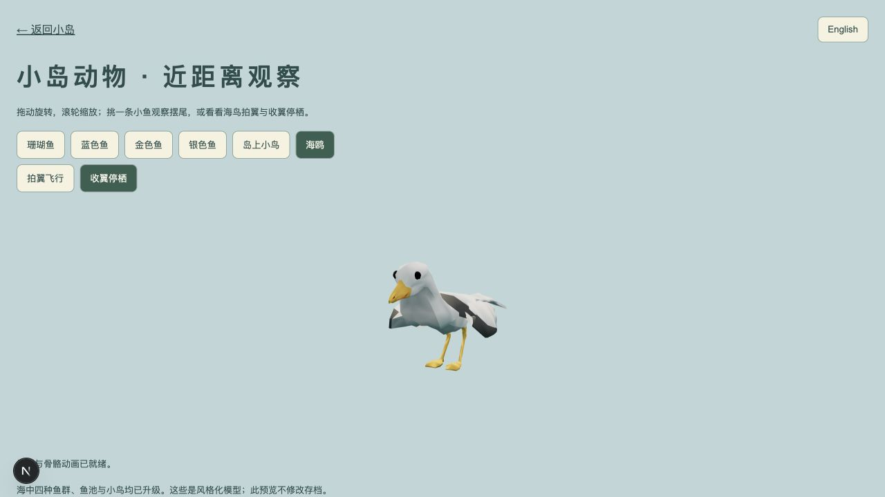

# 小鱼与海鸟模型升级

> 后续更新：2026-11-13 的鲸鱼 / 海豚、海豹、热带树木与沙滩生态见 [热带海岸升级记录](marine-tropical-upgrade.md)。下文保留 2026-11-11 的模型阶段范围。

日期：2026-11-11。此文取代上一轮“只试用一种珊瑚鱼”的当前状态说明；旧试用记录保留作历史。

## 素材与许可

### Quaternius Animated Fish Pack

- 作者：[Quaternius](https://quaternius.com/packs/animatedfish.html)。使用早期 Animated Fish Pack 的 Fish1 / Fish2 / Fish3。
- 原始包来自[作者在 OpenGameArt 的发布页](https://opengameart.org/content/animated-fish)，该发布及包内许可为 CC0 1.0。[原 ZIP](https://opengameart.org/sites/default/files/Animated%20Fish%20Pack%20by%20%40Quaternius.zip)。本项目依据这份原始 CC0 授权，不将作者网站其他新素材的许可一概视为 CC0。
- 未修改的源文件位于 `code/assets/source/quaternius-fish/`，原许可保存在 [License.txt](../../code/public/models/quaternius-fish/License.txt)。
- `node scripts/convert-fish.mjs`（在 code/ 运行）使用现有 Three.js FBXLoader / GLTFExporter 导出 GLB，保留骨骼和约 1.29 秒游泳动画，将材质转换为 MeshStandardMaterial。按材质合并原 FBX 的零碎面分组，使每种模型最多三个 GLTF mesh primitive。
- FBXLoader 读取 Fish2 时提示部分顶点超过四个蒙皮权重，会保留四个权重；预览已检查摆尾和鱼鳍，但未逐顶点对照 Blender 原动画。

### Mesh2Motion 鸟类

- 来源：[Mesh2Motion 开源仓库](https://github.com/Mesh2Motion/mesh2motion-app)。仓库 README 的 Licenses 明确区分：代码 MIT，模型 / 骨架 / 动画 CC0；[原 CC0 文件](https://github.com/Mesh2Motion/mesh2motion-app/blob/main/LICENSE-CC0.MD) 已随项目保留在 [LICENSE-CC0.md](../../code/public/models/mesh2motion-birds/LICENSE-CC0.md)。
- 下载目录为仓库 `static/assets/bird/`：`model.glb`（本地命名 bird.glb）、`variations/seagull.glb`、`animations/flap.glb`、`animations/glide.glb`、`animations/idle.glb`。
- 未修改的下载文件保存在 `code/assets/source/mesh2motion-birds/`，不在游戏运行时请求 GitHub 或其他外部 CDN。
- `node scripts/convert-birds.mjs`：使用现有 Three.js MeshoptDecoder 解压源数据，将原调色板纹理烘焙为线性顶点颜色，合入 Flap / Glide / Idle 三段动画，导出无需纹理解码器的独立 GLB。使用当前 Next.js 依赖中的 sharp 读取源 PNG；sharp 仅用于离线转换。
- 海鸥保留原色；岛上小鸟将灰白羽色调整为暖棕色。两者基于相近鸟类造型，并非经动物学核验的两个真实鸟种。

## 运行时行为

- 海洋 30 条小鱼全部升级：gold → Fish3 金色条纹变体，blue → Fish2，coral → Fish1，silver → Fish1 银色变体。保留四种钓获分类、ID、路线和钓鱼规则。
- 运行时加入一对共享几何的眼睛，附着各自 Face 骨骼；每条鱼独立克隆骨骼与 AnimationMixer。眼睛为本项目程序几何，不是额外下载素材。鱼鳍 / 尾部使用原作者动画，个体有不同速度与相位，鱼群轻微侧摆。
- 鱼池按保存的鱼种显示同样的模型，缩放为海鱼的 0.43；测试确认实际动画顶点位于池底与水面之间。存取规则与容量保持原实现。
- 10 只鸟使用独立骨骼，海鸥与小鸟分配不同模型 / 比例；Flap、Glide、Idle 按飞行 / 滑翔 / 停栖混合。方向跟随实际位移，转弯轻微倾斜，树枝消失时保留平滑飞离行为。夜间小鸟停栖，海鸥隐藏；减少动态效果偏好使用静态姿态。
- 每个海洋 / 鱼池 / 鸟群场景内共享模板几何与材质，实例独立动画。按模型类别降级；加载失败保留原程序模型，场景销毁后迟到的结果释放资源。
- `/fish-preview` 扩展为双语动物观察页：四种鱼、两种鸟外观，拍翼 / 停栖切换，原程序鱼作造型对照；预览不访问存档 API。修复画布在 flex 排版中不断变高的问题。

## 验证与限制

- 51 项测试通过，含实际 GLB 骨骼动画 / 独立克隆、材质批次、减少动态效果、所有鱼群 ID / 钓获移除、鸟栖息点变化、鱼池类别 / 数量 / 水下高度和迟到资源清理。
- Next.js 构建通过。浏览器检查鱼 / 鸟近景、英文界面、白昼和午夜主场景，相关页面错误与警告日志为空；也观察到窄屏按钮换行。
- 加载原岛屿显示 49 木材、16 石料、鱼篓 1 条、鱼池 1 条，没有执行采集 / 建造 / 存取鱼或管理修改。本轮没有重跑实际 API 写入测试或完整移动→采集→建造→钓鱼→刷新流程。
- 当前仍为风格化低多边形动物，不是写实扫描模型；没有新增物种图鉴、人物模型或大型访客模型。未量化帧率 / GPU / 内存，未做跨浏览器、低端设备或长时间稳定性验收。

## 本项目运行截图

[白天主场景](animal-island-day-2026-11-11.png) · [夜间主场景](animal-island-night-2026-11-11.png)。截图是本项目运行结果，静态图不能证明完整动作节奏。

## 文件校验

下列 SHA-256 用于辨认下载源及当前导出物；重新转换后以实际文件为准。

| 文件 | 字节 | SHA-256 |
| --- | ---: | --- |
| `code/assets/source/quaternius-fish/Fish1.fbx` | 98,156 | `1adea1cca2f02f351cf524b60d2448502e3acb3ef2965f74a21c45a5dfce77e3` |
| `code/assets/source/quaternius-fish/Fish2.fbx` | 97,996 | `ab12853cbd9c205a3aeb1d2cff1fd0cced44e5faa707020637bfd41634201509` |
| `code/assets/source/quaternius-fish/Fish3.fbx` | 87,468 | `142bb6559b928c61ff839eecbba4ee0cfafa964df37720db6a6ba3a90b4ed639` |
| `code/assets/source/mesh2motion-birds/bird.glb` | 128,204 | `dd13844423b47525481fed32233f590465ef73384a1c06ca1954e09316a848e6` |
| `code/assets/source/mesh2motion-birds/flap.glb` | 50,560 | `9e0eb76dbd17029af3eef85a10d0180da3c0f6faaac0baaf8f9b1a47db200cd8` |
| `code/assets/source/mesh2motion-birds/glide.glb` | 50,760 | `383c754618b6bf23ac1601ab824553aca99ce08172c05f86372404f40cffdcaa` |
| `code/assets/source/mesh2motion-birds/idle.glb` | 50,312 | `2ec6e177a217ebb70e80bc0dde16baf3907a12f86c23427e6ba0895c67d3f53e` |
| `code/assets/source/mesh2motion-birds/seagull.glb` | 131,500 | `ece6abb2400c6267115fe0bb168b086491e2ce4ab25751e9759d957b3c70c4d5` |
| `code/public/models/quaternius-fish/Fish1.glb` | 113,592 | `4c47033334f3e4ec500776f4493cfe3cb07afa4c95828d8fb9208135b4ad9f1a` |
| `code/public/models/quaternius-fish/Fish2.glb` | 107,744 | `70fb2e99b39cd703a72a2260bcf859315a82446219eb365b4d0ccaeedb568794` |
| `code/public/models/quaternius-fish/Fish3.glb` | 127,752 | `ec1b98347f18271e61dd1bc5e89a33865cca11e90be7ffbb11adb3e06ac08693` |
| `code/public/models/mesh2motion-birds/bird.glb` | 389,556 | `549e0c71f2a5fab404c4d3d118c4a9393401cacfd9d67473a92aa7b089efa5d5` |
| `code/public/models/mesh2motion-birds/seagull.glb` | 393,456 | `c86b871b2f2dabaa6da72f24cee700b2961d0fb77eac59bac997f14d1da47f39` |
