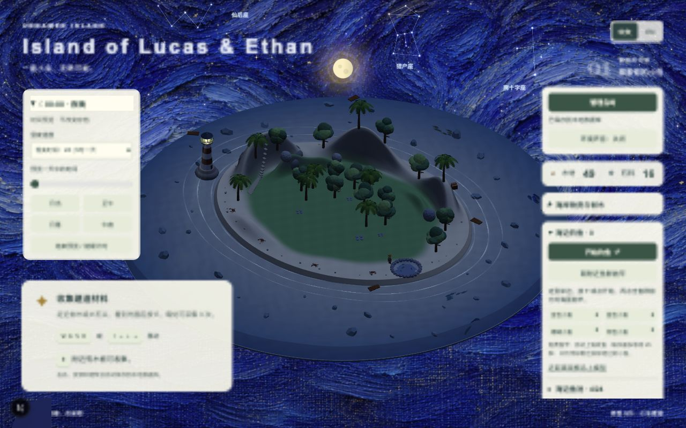
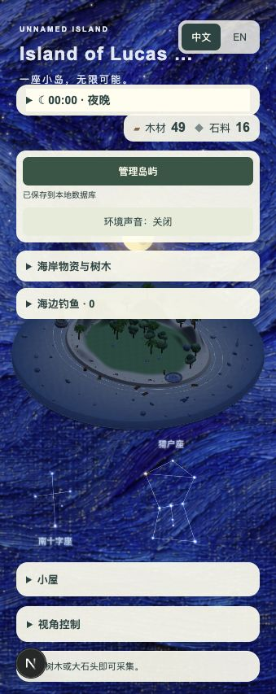

# 细致星光与星座

更新：2026-11-13。

## 本轮实现

保留蓝色厚涂旋涡、细星点、✨ 星芒和独立月亮，增加三组可辨认的简化轮廓：仙后座五颗星的 W 形、猎户座腰带三星 / 肩脚 / 剑、南十字座的长短轴。主星有不同尺寸和亮度、冷白与暖色（猎户座左肩）、小星心 / 柔光与轻微独立闪烁；连线细淡，名称跟随中文 / English 切换。

宽屏三组位于画面上方；竖屏只在岛屿下方的空白油画背景显示猎户座与南十字座，避开顶部界面。它们是适合当前画面的手写艺术构图，不是天球坐标、真实观测方位或按时间 / 地点计算的星图；标签不表示这些星座此刻都能从现实地点看到。

星座随夜间亮度渐显，白天隐藏；月亮附近淡出星点 / 连线，减少动态效果时固定闪烁时间。绘制顺序在天空之后、岛屿之前，避免浮在陆地上；不进入平面水面反射。标签切换和尺寸变化时释放旧几何、标签材质与纹理，场景销毁时释放共享材质。不修改存档、数据库、昼夜规则或其他玩法。

## 代码与来源

- `code/src/game/constellations.js`：原创简化点线数据与宽窄屏布局。
- `code/src/game/constellationView.js`：Three.js 星点着色器、细线及本地 canvas 标签。
- `sky.js` 驱动夜间亮度、月亮位置与减少动态效果；`createGame.js` 提供语言入口，`IslandGame.js` 同步界面语言，名称集中在 `messages.js`。
- 没有下载新的模型、图片或星表。点线为手工简化，不复制天文图资产。星座名称 / 图形背景参考 [IAU 星座说明](https://www.iau.org/IAU/Astronomy-FAQs/Constellations.aspx) 与 [NASA 猎户座说明](https://science.nasa.gov/asset/hubble/orion-constellation/)，未使用其图片。
- 原油画贴图来源与生成提示词继续见 [细星空记录](fine-stars-explorer.md)。

## 验证与限制

- `npm --prefix code test`：65 项通过，包括新点线数据、非零连线、猎户座腰带三星共线、多个宽高比下布局边界与比例。
- `npm --prefix code run build`：通过。
- 浏览器目视检查 1280×800 的三组星座与名称；339×853 的两组星座，中文 / 英文标签切换；午夜显示和正午隐藏。错误 / 警告日志为空，临时宽屏视口检查后已恢复。
- 未做实时天文学、全星空覆盖、跨浏览器 / GPU 性能量化、完整采集建造钓鱼回归或真实 API 写入检查。静态截图不能证明完整闪烁时序。

