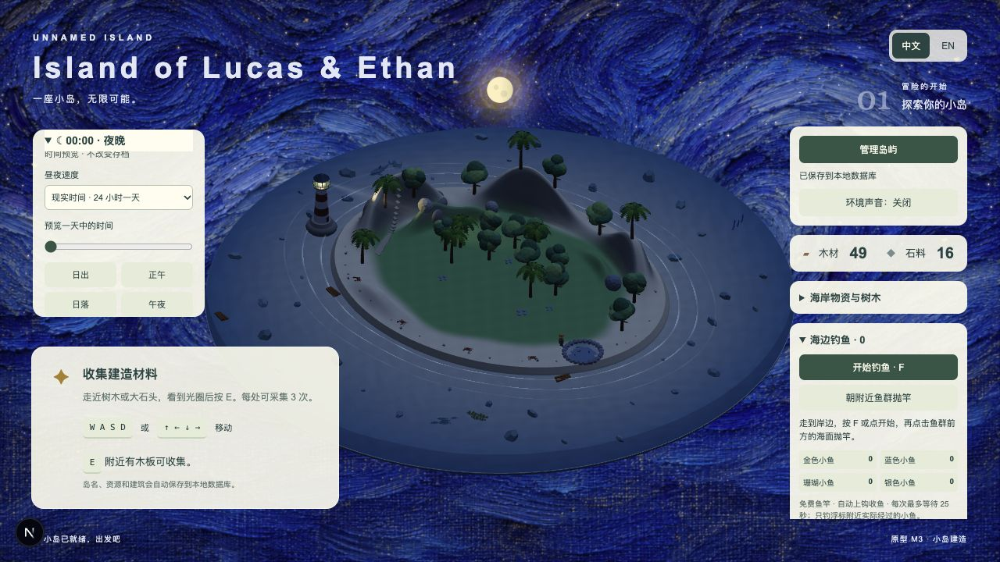
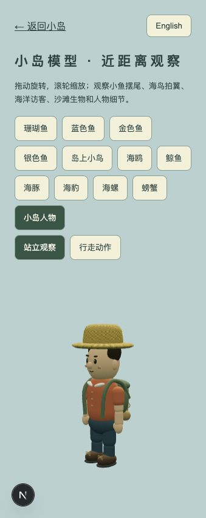

# 细星空、星芒与人物细化

日期：2026-11-13。用户要求保留当前油画夜空，缩小星星、加入闪烁和适当柔化，并细化建模；“任务的建模”本轮按人物建模处理，另按后续要求加入少量 ✨ 四角星芒。

## 夜空位图与来源

使用内置 image_gen 的编辑模式（非 CLI），以项目原有 `oil-night-v1.png` 为编辑目标。保留钴蓝 / 群青旋涡、画布与厚涂笔触，将原来的大金色星团 / 光晕改为周围蓝色画笔纹理，只留极少小金色颜料点。图中没有月亮，月亮继续由游戏叠加。

- 新资产：[oil-night-small-stars-v2.png](../../code/public/textures/oil-night-small-stars-v2.png)，1671×941，3,842,052 字节，无透明通道。
- SHA-256：`0ec4d94f8ac3ee8d3d4b397f779a0aa31aa6a932a280afe6c3d4c1fbb910321d`。
- 原始内置输出：`/Users/binli/.codex/generated_images/01a1a69b-8da4-7ea2-92d1-a872eb226132/exec-8a21cdf7-0e71-49ca-a30c-cf566627b0b1.png`；已复制到项目，游戏不依赖该默认目录。
- 原 v1 保留作历史。此文件是项目 AI 生成 / 编辑的位图，不是第三方原画扫描或下载素材，不声明为 CC0；沿用生成服务适用条款。

### 完整编辑提示词

Edit target: the supplied night-sky oil painting texture for a Three.js game. Preserve the sweeping cobalt/ultramarine swirls, composition, palette and tangible impasto oil-paint bristle/canvas texture. Change the stars: remove ALL large yellow circular star discs and their broad golden halos, including the large upper-left, upper-middle and middle-right spots; fill those areas seamlessly with the surrounding blue painted sky strokes. Keep only sparse TINY delicate cream-gold paint flecks, each at most 0.15 percent of image width, with very restrained soft edges; no circular star halos, no star larger than a tiny speck. The game will overlay its own animated stars and a single moon, so this is primarily a richly textured dark blue swirling sky backdrop. No moon, no sun, no land, no horizon, no text. Maintain landscape aspect ratio and painterly texture; soften contrast of the pale cloud ridges slightly, while keeping oil-paint detail. No bright yellow patches anywhere that could be confused with a moon.

## 程序星点与 ✨

`sky.js` 将画面和星光分开：

- 位图用少量邻近采样柔化，保留厚涂风格。微小颜料点仍是静态背景，不将其冒充程序闪烁星星。
- 细星心按 CSS 像素尺寸控制，半径约 0.48–0.96 像素，并有较弱柔光；在加载到油画贴图后也持续显示，修正旧实现“有贴图便不绘制程序星点”的行为。
- 少量星点带四角星芒和旁边的小亮点，尖端约 5 像素范围，形成 ✨ 感。每个星芒使用独立位置哈希决定相位 / 频率，缓慢错开闪亮；月亮附近留出空间。
- 月亮保留明显圆盘，改为暖米色，减小宽光晕。星芒与月亮的尺寸和形状不同，避免相混。
- 白天不显示夜空 / 星点；减少动态效果偏好会固定闪烁时间，保留静态星空。

## 人物模型

`explorerModel.js` 是本项目原创程序模型与 DataTexture，没有引入第三方人物素材：

- 以新人物替代原先五个简单几何体，保留原 player 根节点的坐标 / 朝向与游戏数据结构。
- 增加五官、耳朵、头发、眉毛 / 眼睛高光和微笑，圆滑草帽帽檐 / 帽冠、128×64 程序编织纹、衣领 / 纽扣、帆布背包 / 肩带 / 卷毯 / 扣环、裤腿、鞋底 / 鞋带、手掌与拇指。
- 手臂 / 肘部、腿 / 膝部独立关节；行走摆臂与步态过渡，站立有很轻微的呼吸 / 转头；减少动态效果时使用静止姿态。仍为风格化程序角色，没有脚部 IK 或写实皮肤 / 布料模拟。
- 钓鱼姿态抬臂，鱼竿起点改用右手实际世界坐标，跟随人物朝向和位置。只修改表现，未改变抛竿、上钩或资源规则。
- `/fish-preview` 增加“小岛人物”，支持近看、旋转缩放与站立 / 行走切换；新文字中英文集中维护，页面不访问存档 API。

## 验证与限制

- 63 项测试与 Next.js 构建通过。人物新测试覆盖鞋底接近地面、模型高度、关节动作 / 减少动态效果，以及钓鱼握点随人物移动 / 旋转同步。
- 浏览器检查了人物正侧面、背包、五官、草帽与姿态切换；检查午夜、白天太阳与夜空切换，页面错误 / 警告日志为空。固定夜景截图的天空区域两帧存在亮度变化，支持星点并非静态；未录制连续视频或逐星光度验收。
- 未执行这一版完整移动→采集→建造→钓鱼→刷新人工闭环，未重跑实际 API 写入，未验证全部镜头与触控极限，也没有 GPU / 帧率 / 低端设备量化。
- 存档结构和生产配置未改。最近加载的材料为木材 49 / 石料 16、鱼篓 0 / 鱼池 4；未执行资源 / 建筑 / 鱼池管理修改。

## 实际运行截图

静态图不显示完整闪烁和步态节奏。
