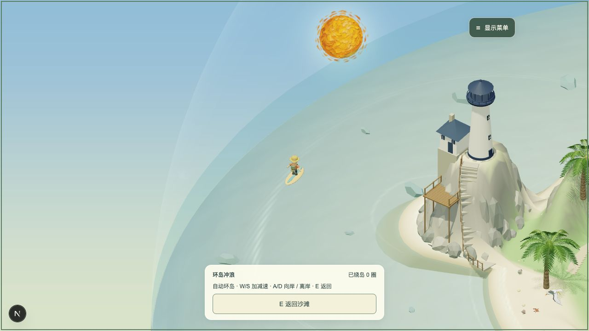
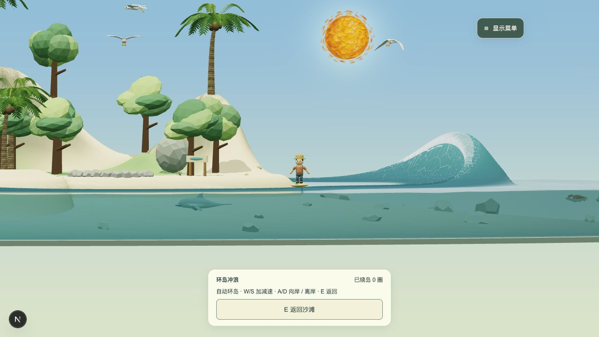
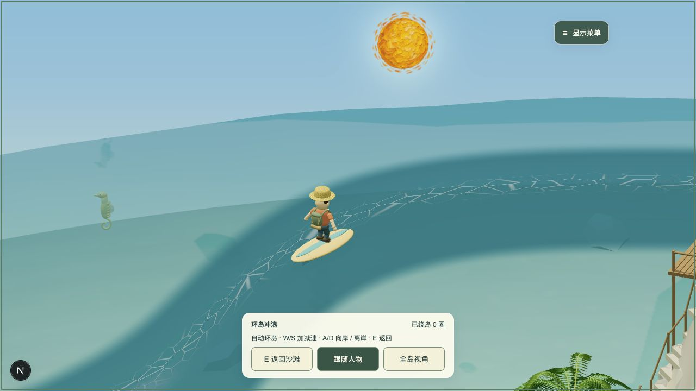
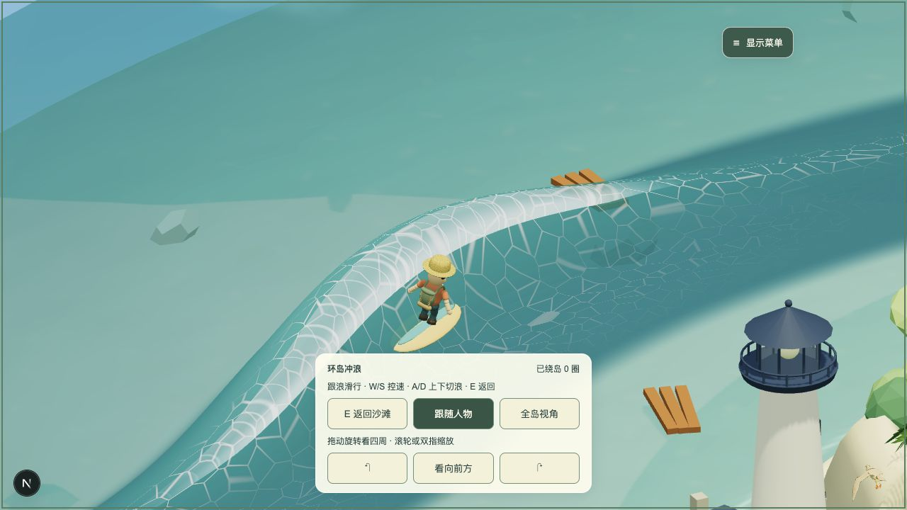

# 环岛冲浪 / Island surfing

2026-11-19。扩大海面半径为 43；陆地、浅滩和建筑位置不变。

到东岸木架附近（视角面板 → 东岸冲浪板），按 E 或“上板冲浪”。自动沿岛环行，W/S 加减速，A/D 向岸 / 离岸，E / Esc 返回沙滩。镜头跟随角色，支持拖动和缩放；专注模式仍保留回岸按钮。没有落水惩罚。

- surfing.js：取板距离、路线平滑曲线、控制 / 圈数 / 返岸安全点；不依赖 Three.js。
- surfView.js：木架 / 冲浪板 / 尾浪；人物姿态在 explorerModel.js。
- orbitWaves.js：环岛涌浪外观；原 shoreWaves.js 继续表现近岸拍浪。
- createGame.js：键盘 / 按钮、镜头、状态互斥和保存边界。冲浪期间存档坐标取自有效岸上位置，刷新不会困在海中。圈数和冲浪动作不存档。

全部新增造型为项目内程序几何，无新增下载素材。测试与发布状态见 [开发进度](../progress.md)。本地实测截图：

## 大浪材质更新

参考用户后续两张图片，将平面浪线改为立体水壁与独立翻卷浪唇，最高约 2.8。surfSwell.js 提供 JS / GLSL 一致的浪高，冲浪板按航道 / 时间贴合并随坡面倾斜。程序网状泡沫集中于波峰；海水色深、反射扰动、浅水焦散与水下海床配色同步调整。仍为风格化视觉，不是完整流体模拟；参考图未作为游戏素材复制。

## 人物跟随镜头

上板默认进入第三人称近景，平滑跟随行进方向并弱化垂直颠簸。冲浪卡片中的“跟随人物 / 全岛视角”按钮随时切换，当前模式高亮，专注模式也可见。拖动可以调整相对观察角度；回岸恢复木架附近镜头。模式是当前会话设置，不进入岛屿存档。

跟随时可拖动环视，松开保留相对方向；冲浪卡片另有左右旋转按钮及“看向前方”，不会中断移动跟随。按钮旋转与拖动使用同一角度记忆。

## 同浪滑行更新

入水时接最近的可见浪包，人物与浪使用同一推进相位，W/S 在浪肩前后有限控速，A/D 在迎浪面上下切浪；不再以独立速度绕岛追丢波峰。波浪 / 角色在管理暂停时共用冻结时钟。仍是辅助跟浪原型，没有完整换浪、落水或流体模拟。

