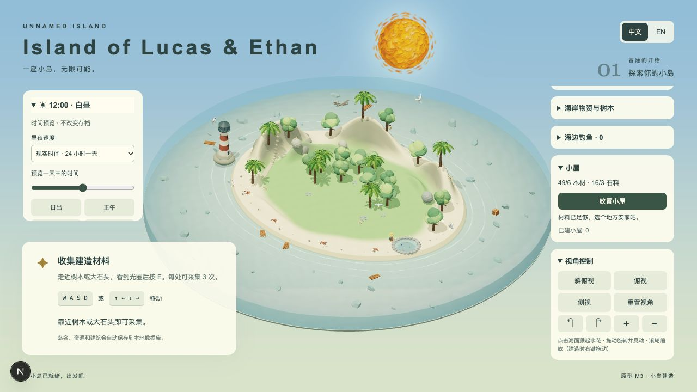

# 海水、海洋访客与热带海岸升级

日期：2026-11-13。承接 [鱼与鸟类模型](animal-models.md) 和 2026-11-11 灯塔阶段。新增功能仍为视觉与生态表现，不改变材料、钓鱼分类、建造配方或数据库结构。

## 海水与倒影

原水面和透明侧壁均使用高 transmission 的屏幕空间透射。此轮移除这两层透射及室内 RoomEnvironment，改为一层透明水面与独立透明侧壁，避免用错位的折射画面重复绘制水下物体。

- `waterReflection.js` 使用 Three.js 自带 Reflector 镜像相机，反射目标为 512×512、无 MSAA，裁切水面以下场景。
- 混合权重随观察角度变化：俯视更多看到水下，低角度增加倒影；反射图轻微模糊，波纹只作小幅扰动。水下动物增加随深度变化的青蓝色调。
- 绘画天空是屏幕空间平面，反射时隐藏，用昼夜环境色代替；透明侧壁、水花与细小沙滩装饰也不进入反射。不是完整物理天空、折射或流体模拟，水面起伏与反射面之间仍为近似。
- 保留果冻弹性、点击水花、岸浪、鱼群真实候选与海洋边界裁切。反射会增加一次场景绘制；没有完成 GPU / 帧率 / 低端设备量化。

## 鲸鱼与海豚素材

两者来自与 Fish1 / Fish2 / Fish3 相同的早期 Quaternius Animated Fish Pack：

- [作者的 OpenGameArt 发布页](https://opengameart.org/content/animated-fish)及[原 ZIP](https://opengameart.org/sites/default/files/Animated%20Fish%20Pack%20by%20%40Quaternius.zip)。依据原发布和包内 CC0 1.0 许可；不推断作者其他新素材也使用同一许可。
- 原 FBX 保存至 `code/assets/source/quaternius-fish/Whale.fbx` 和 `Dolphin.fbx`，未经修改。原 [License.txt](../../code/public/models/quaternius-fish/License.txt)继续随项目保留。
- `node scripts/convert-fish.mjs` 在 code/ 执行，现同时导出三种鱼、鲸鱼和海豚。鲸鱼与海豚删除原逐面法线、按完整顶点属性焊接后重算法线，合并材质分组，保留蒙皮和游泳动画。FBXLoader 对超过四个蒙皮权重的顶点保留四个权重；未逐顶点与 Blender 原动画比对。
- `marineModels.js` 将鲸鱼长度归一至约 6 单位、海豚约 3.1 单位；保留独立骨骼，改为灰蓝背部 / 浅腹色，并增加跟随头骨的程序眼睛。Whale 游泳动画约 2.79 秒，Dolphin 约 1.04 秒。每种模板共享几何与材质，加载失败保留原程序模型。

| 文件 | 字节 | SHA-256 |
| --- | ---: | --- |
| `assets/source/quaternius-fish/Whale.fbx` | 137,980 | `56cbdb5a6eeb8f9d334440fe384b7849eb84fba1ce03d8df9a997be981cbb8d9` |
| `public/models/quaternius-fish/Whale.glb` | 68,352 | `3bc754e091357aafe7ccdf31b8983c516a1e4c18f37220b6a3f96e46e61b6c3c` |
| `assets/source/quaternius-fish/Dolphin.fbx` | 130,796 | `4b6f1ff9487bf25bd3dd7e3397723a356579ee9e3d62e915f978c003ee41644f` |
| `public/models/quaternius-fish/Dolphin.glb` | 61,652 | `707fc77a965c0d4031f3820228935e70bda3359e9548764046f35cb6f6cb680b` |

路径相对 code/。运行时不请求外部素材站。

## 鲸鱼动作与独立海豹

- 鲸鱼在经过海域中段时可进行约 4.2 秒的跃水：抬头、升起、侧滚、俯冲落水，起跳和落水各触发一次水花，落水较大。首轮提供一次，之后每次重新经过以 65% 概率安排；不是每次巡游都持续跳跃。
- `whaleBehaviour.js` 只计算位移 / 姿态。游泳动画使用累计时间，变速时保持相位连续；减少动态效果时不跃水，也不产生自动跃水水花。
- 保留海豚，新增独立海豹。`sealModel.js` 为本项目程序几何，包含连续收尖身体、圆头、无外耳轮廓、胡须、前鳍与成对后鳍，鳍肢有游动动作。不使用 Gobkit 或许可不明素材。
- 鲸鱼、海豚、海豹和章鱼为观赏访客，不进入小鱼钓获候选、不写入存档。

## 灯塔、海螺、螃蟹与树木

以下全部是本项目程序几何 / 着色器，没有新增第三方美术素材：

- 灯塔使用三层淡光束形成核心和外缘，边缘按视线淡出、沿距离衰减并有轻微雾感变化；重新对齐聚光灯方向与海面，保留暖色灯室、光晕、昼夜渐变和减少动态效果时静止。
- `coastalLife.js` 的海螺为带螺旋起伏的实体壳、壳口和末端管状轮廓，几种浅色变体分布于沙滩。四只小螃蟹有蟹甲、眼柄、八条步足与两只蟹钳，沿沙滩横行，避开鱼池。它们是装饰，不新增采集或捕捉规则。
- `palmTree.js` 的椰子树包含弯曲收尖树干、环纹、羽状叶和椰子；与原阔叶树、宽扁伞状树冠按稳定顺序混排。羽叶与叶轴合并为单个树冠绘制批次，风摆作用于树冠。
- 资源树沿用原 ID / 木材收益 / 生长状态，椰子树同样随资源树整体缩放生长；装饰树仍常驻。只有可见且接近成熟的树提供栖息点，椰子树的停栖高度随新造型调整。
- `/fish-preview` 增加鲸鱼、海豚、海豹、海螺与螃蟹；窄屏按比例调整取景。新增文案集中维护中英文，页面不访问存档 API。

## 已验证与未验证

- 61 项测试及 Next.js 构建通过。新增实际鲸鱼 / 海豚 GLB 的大小、朝向、独立骨骼；镜像相机的反射高度与场景恢复；跃水轨迹、每轮两次水花与减少动态效果；树形 / 资源 ID / 栖息点，以及螃蟹陆地 / 鱼池边界。
- 浏览器检查动物近景、海螺 / 螃蟹完整取景、中文 / 英文新增选项；主场景检查正午、午夜、侧视、旋转、椰子树及沙滩装饰，相关页面错误 / 警告日志为空。看到鲸鱼在水面上方活动及水花；完整跃水时序和每轮事件数量主要由规则测试验证，未录制连续视频逐帧验收。
- 本轮加载存档显示木材 49、石料 16、鱼池 4、鱼篓 0；没有执行采集、建造、鱼池存取或管理修改，没有重跑真实 API 写入回归。
- 当前仍是风格化模型，非写实扫描；没有定量性能测量、多浏览器 / 低端设备 / 长时间稳定性验收，也没有生产部署验证或完整玩法人工回归。

## 本项目截图

[鲸鱼近景](whale-preview-2026-11-13.png) · [海豹近景](seal-preview-2026-11-13.png) · [海螺](conch-preview-2026-11-13.png) · [螃蟹](crab-preview-2026-11-13.png) · [侧视水面](water-reflection-side-2026-11-13.png) · [细化后的灯塔](lighthouse-refined-2026-11-13.png)。静态图不代表完整动作节奏或定量性能结果。
