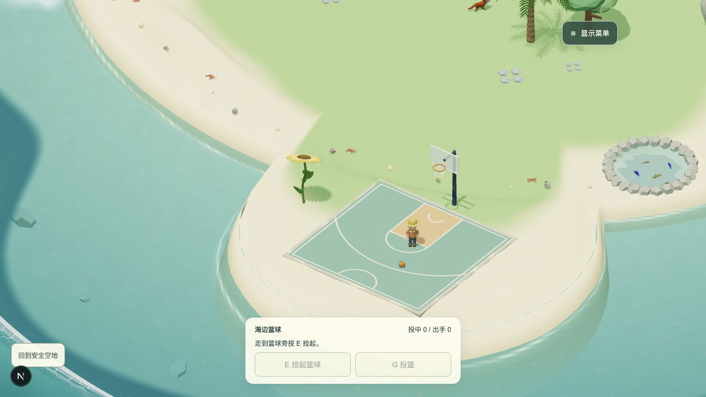

# Rapier 与自然伙伴动作

2026-11-20。本轮只接第一阶段主体碰撞，不重做全部游戏物理。

## 三个学习概念

1. **Three.js 模型**：负责看到的人物、猫狗、房屋和动画。
2. **碰撞体 Collider**：看不见的简化形状。人物和动物用胶囊，房屋用方盒，树石 / 水池用圆柱。主体略留缓冲，避免动画摆动时频繁碰撞；尾巴并未逐段物理化。
3. **CharacterController**：AI 或键盘先提出期望移动，Rapier 检查沿途障碍、修正可走距离，再把结果同步给模型。动画不能绕过碰撞直接移动主体。

## 代码入口

- islandPhysics.js：异步初始化、建立世界、静态碰撞增删、角色登记 / 定位、形状扫掠移动、销毁。
- createGame.js：共用世界，人物输入与胶囊位置、建筑 / 资源改变、冲浪禁用碰撞与回岸恢复。
- pets.js：自主行为、加减速 / 限速转向、邻居避让、稳定绕障和受阻重选；渲染无关，可在 Node 测试。
- petView.js：把 AI 的期望移动交给同一个 Rapier 世界，依据真实位移播放步态，平滑地面显示。
- petAssetModel.js：0.22 秒动画目标稳定窗口、交叉淡化、保留循环走跑相位，只对睡坐重置。

动物相遇先礼让，碰撞控制器兜底阻挡。遇到复杂地形仍可能停住再选路，这不是完整导航网格系统。暂不增加篮球刚体、海水物理或布娃娃。

## 依赖和依据

锁定 npm 官方包 @dimforge/rapier3d-compat **0.21.0**，包元数据及官方 README 标注 **Apache-2.0**。WASM 内嵌随应用部署，没有运行时第三方 CDN 下载；不会引入新的美术素材许可。

官方指南：[初始化与 compat 包](https://rapier.rs/docs/user_guides/javascript/getting_started_js/)、[角色控制器](https://rapier.rs/docs/user_guides/javascript/character_controller/)。本轮使用官方支持的独立 Collider + 控制器位移查询，尚未引入动力学刚体；地面高度仍沿用已保存岛屿的采样函数。

## 验证范围

111 项游戏测试通过，覆盖高速扫掠、贴墙、互相阻挡、六只动物持续活动、静态变化、骨骼短暂停走连续性及旧玩法；Next.js webpack 生产构建通过。浏览器没有 error / warn。未验证真实手机性能、全部尾巴 / 四肢接触或长时间内存，未发布 NAS。

