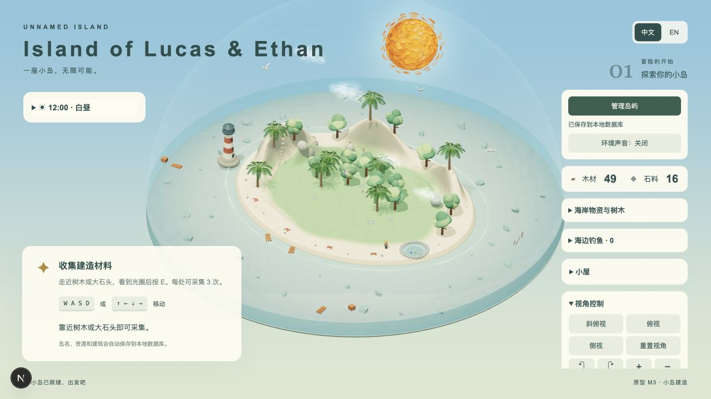
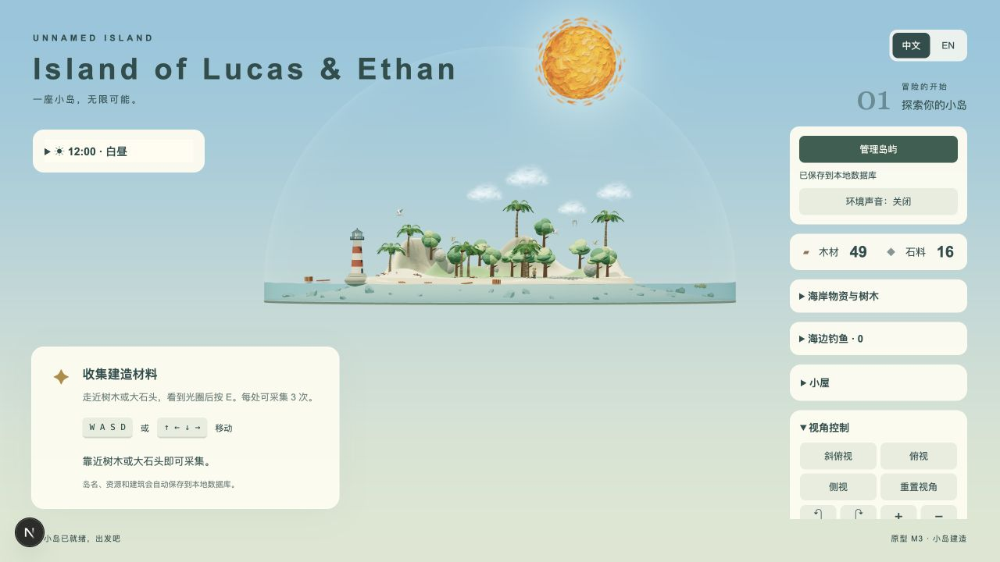
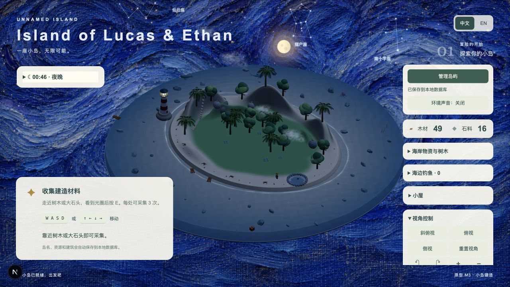

# 球形天空、雾状云与沙滩细浪

更新：2026-11-14。全部为项目原创程序几何与着色器，无新增外部素材或许可依赖。

## 画面与边界

- 与海面同半径 33、底圈 Y=-0.12 的透明上半球，用淡淡轮廓光勾出小岛上空的空间。只展示球体上部，不增加碰撞、玻璃折射或天气规则；默认镜头可能裁去顶部，缩小可看完整轮廓。
- 七组云采用面向镜头的雾片，程序噪声、柔边和低透明度形成轻盈云絮；每组七片合为一次绘制，几何 / 材质共享。云从球外经过内部，再向球外离去；外沿 4 单位逐渐淡出，周期重置位于球外。日间暖白、黄昏浅桃、夜间灰蓝，减少动态效果时冻结云路线与纹理流动。
- 四只海鸥改为跨球路线、球外重置，其骨骼模型和原程序回退模型都按世界坐标在球边界淡出；五只小鸟和一只海鸥保持停栖 / 飞行。普通小鸟夜间休息、海鸥夜间隐藏的规则保留。减少动态效果继续固定鸟类骨骼 / 拍翼，鸟的路径位移沿用原行为。
- 沙滩近岸增加贴合岸唇的薄水层，两道错峰细泡沫缓慢向内推进、散去，水光很淡；约 8.5 秒周期，局部错相、断续浪边避免整齐圆线。地形高度、沙滩建造 / 碰撞及海水点击 / 果冻互动不改变。减少动态效果时固定浪花画面。
- 云、上半球与岸浪均排除平面水面反射；没有新增存档、界面文字或数据库迁移。油画天空、日月和星座仍为原来的屏幕空间艺术表现，不强行塞入世界球体。

## 实现入口

`code/src/game/skyVolume.js`：共享球形参数、可见度、鸟材质边缘淡出与透明上半球。`clouds.js`：雾片 / 路线 / 云色。`birds.js`：访客航线、停栖与加载后的材质接入。`shoreWaves.js`：贴岸几何和泡沫 / 水光。`createGame.js`：昼夜同步和生命周期清理。游戏规则和数据库保持分离。

## 验证与限制

67 项测试通过，包含新增球形边界淡出和海鸥跨界 / 球外重置 / 夜间隐藏验证。Next.js 构建通过。Node 场景检查确认云移动、云 / 岸浪减少动态效果、几何有限值及销毁后移除。

浏览器默认 1280×720：正午 / 夜间、斜视 / 放大 / 侧视 / 缩小后的完整边界已目视检查，可见云朵位移和岸线细浪，骨骼鸟与雾云 shader 正常渲染，错误 / 警告日志为空。只操作镜头、时间预览和面板；未进行存档管理或资源编辑。

未逐只录制完整云 / 鸟进入和离开周期，边缘淡出 / 航线重置主要靠共享范围与路径测试验证；未验证完整核心玩法闭环、API 写入、跨浏览器、低端设备或透明叠加的定量 GPU 成本。不是体积光云层或完整海浪流体模拟。

