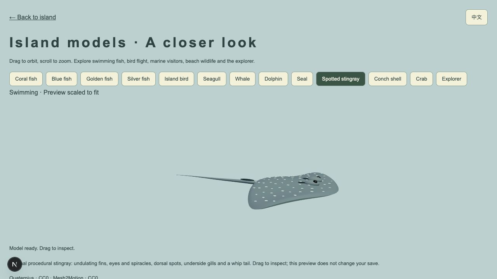

# 斑点魟鱼 / Spotted stingray

2026-11-19。按用户要求加入更细致的 stingray，源代码为项目原创 stingrayModel.js，没有下载或转换第三方模型。

连续鳍盘 / 浅色腹部、眼睛及喷水孔、背部斑点、鳃裂与口部、渐细长尾；独立胸鳍连续变形与长尾摆动，减少动态效果固定。斑点用低面数实例绘制，资源随海洋场景释放。巡游不参与钓获或存档。

可从“近距离观察岛上模型”选择斑点魟鱼，拖动旋转、滚轮缩放。该模型是较细致的风格化程序造型，不是扫描或照片级资产。几何、动画和场景集成测试已通过；手机性能未量化。

