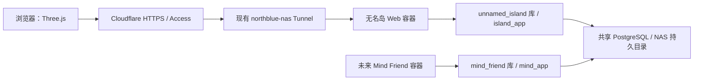

# 无名岛 NAS 首次部署计划

更新：2026-11-16。用户已选择共享 PostgreSQL，以及自己 / 家人共用当前岛屿。仅使用 UGREEN 图形界面操作 NAS。本文取代此前普通 SQLite 的部署建议；当前游戏默认仍运行 PrismaD1 / SQLite，已有可选 PostgreSQL 接入和独立迁移文件，尚未迁移。

## 已准备与未完成

已准备 [PostgreSQL 图形界面配置包](../deploy/postgres/README.md) 和 [上传 ZIP](../deploy/nas-postgres-setup.zip)：Compose、数据库 / 角色初始化、可选准备 / 验证 / 备份脚本。静态和脚本模拟检查通过；当前 Mac 无 Docker，NAS 客户端自动读取不稳定；用户在 UGREEN 部署后提供日志，确认 PostgreSQL 17.12 服务正常运行，项目库 / 所属角色及 vector 0.8.7 已由后续用户查询截图核实，mind_app 密码登录、隔离检查已有截图 / 用户反馈；第一次逻辑备份与当前空库的临时库恢复已通过。真实业务数据、重启回归和空新实例整机恢复尚待验证。

已准备 [小岛独立容器与镜像发布文件](nas-island-container.md)，本机 standalone 隔离检查和 Linux 镜像 / 临时 PostgreSQL 云端验收已通过；已发布 GHCR 并固定 Compose 摘要，尚未在 NAS 运行应用或接生产域名 / Access，未修改存档。现有 D1 的数据保留。

## 目标结构

每项目独立库 / 账号 / 迁移。PostgreSQL 容器和 Web 容器分开更新，数据库不发布宿主机端口或 Tunnel。Mind Friend 库预留 pgvector，不代表其 AI / 索引 / 应用已经接入。纯小岛无需 Ollama，三维场景由浏览器渲染。

## 第一步：先建立数据库基础服务

1. 用户下载 ZIP，上传至 NAS 独立 nas-postgres 目录并解压；建立专用空 data 目录。
2. 在 NAS 复制 .env.example 为 .env，填写实际数据 / 备份目录和三个不同的随机密码。密码不发送到聊天，配置不提交 Git。
3. UGREEN 项目导入 compose.yaml，核对相对路径与 .env，启动 PostgreSQL，查看日志与健康状态。
4. 验证两个项目账号的读写、跨库拒绝、vector 和备份恢复。没有通过验证前不迁移现有游戏。

具体操作以 [配置包说明](../deploy/postgres/README.md) 为准。已核实运行目录 /volume2/docker/nas-postgres，备份目录 /volume1/backup/nas-postgres；独立项目文档见 ../../nas-postgres/doc/README.md。

## 第二步：适配小岛应用

已完成第一小步：[双数据库模式与 PostgreSQL 基线](postgresql-app-adapter.md)。以下仍须逐项验收，已有代码不代表 NAS 已完成应用接入。

- 改 Prisma provider / Node PostgreSQL 驱动和连接配置，去除默认运行依赖 Cloudflare D1 binding；新建 PostgreSQL 基线迁移，不能直接使用 SQLite / D1 SQL。
- Mac 开发采用独立同版本 PostgreSQL / 开发数据库，不指向 NAS 正式库。应用连接池设上限，保留 revision 乐观锁和服务端校验。
- 用明确 APP_ORIGIN 适配域名下写入校验，处理外部 HTTPS / 代理内部 HTTP 差异，不简单删除 localhost 限制。
- 私人 / 家庭共享岛先用 Access 限定访问者，应用验证 JWT，控制源站绕过；不增加每人独立存档，管理面板暂按家庭可信使用，未实现独立管理员角色。
- 增加健康接口、合并 / 限频自动保存，验证重要操作落盘和刷新 / 重启恢复。

## 第三步：迁移当前岛屿

停写后备份原 D1 / SQLite，并导出版本化逻辑存档 JSON。新 PostgreSQL 应用基线迁移后，经校验导入岛名、木石、资源点 / 生长、玩家位置、建筑、鱼篓、鱼池；目标非空时默认拒绝覆盖。比对逻辑内容 / 总量，并做保存、刷新、重启验证。

先前只读基准为 Island of Lucas & Ethan，木材 49、石料 16、建筑 0、鱼池 4；实际导入以迁移时导出数据为准，不能硬编码此基准。原 D1 保留，切换后不自动双向同步 Mac 与 NAS 的进度。

## 第四步：制作并发布应用

Next.js standalone 多阶段 Docker 镜像，包含 public / .next/static 和 Prisma 运行依赖；在 Linux 目标架构安装依赖，不复制 Mac node_modules。UGREEN 运行单独的无名岛 Compose 项目，Web 同时连接入口网络与 PostgreSQL 内部网络。

建议域名 island.northblue.cc，尚未创建。先只读核对现有 cloudflared 网络，复用已有 Tunnel，避免改动 AnythingLLM / Open WebUI。若共用入口网络，route 可指向 http://island-web:3000；名称和网络需实际核对。Access / 应用权限和 Origin 一起验收，再开放路由。

固定流程：Mac 开发 → 测试 / Git 标签 → CI 构建 linux/amd64 镜像 → NAS 备份 → 拉指定版本 → 一次迁移 → 更新 Web → 健康 / 域名 / 保存恢复验收。先手动更新，不添加自动升级服务。保留旧镜像和对应备份；不兼容 schema 回滚需停写并恢复匹配备份。

## 首装待核对

数据库实际目录和 UGREEN 导入已核实；应用入口网络和可用资源仍需检查；Git / 镜像仓库；最终域名、允许访问的家庭成员。数据库创建和应用迁移分步骤实施，不更改其他项目数据。

来源：[PostgreSQL 多库](https://www.postgresql.org/docs/17/manage-ag-overview.html)、[pgvector 镜像](https://github.com/pgvector/pgvector#docker)、[Compose 网络](https://docs.docker.com/compose/how-tos/networking/)、[Next.js 自托管](https://nextjs.org/docs/app/guides/self-hosting)、[Cloudflare Tunnel](https://developers.cloudflare.com/cloudflare-one/networks/connectors/cloudflare-tunnel/routing-to-tunnel/)。
